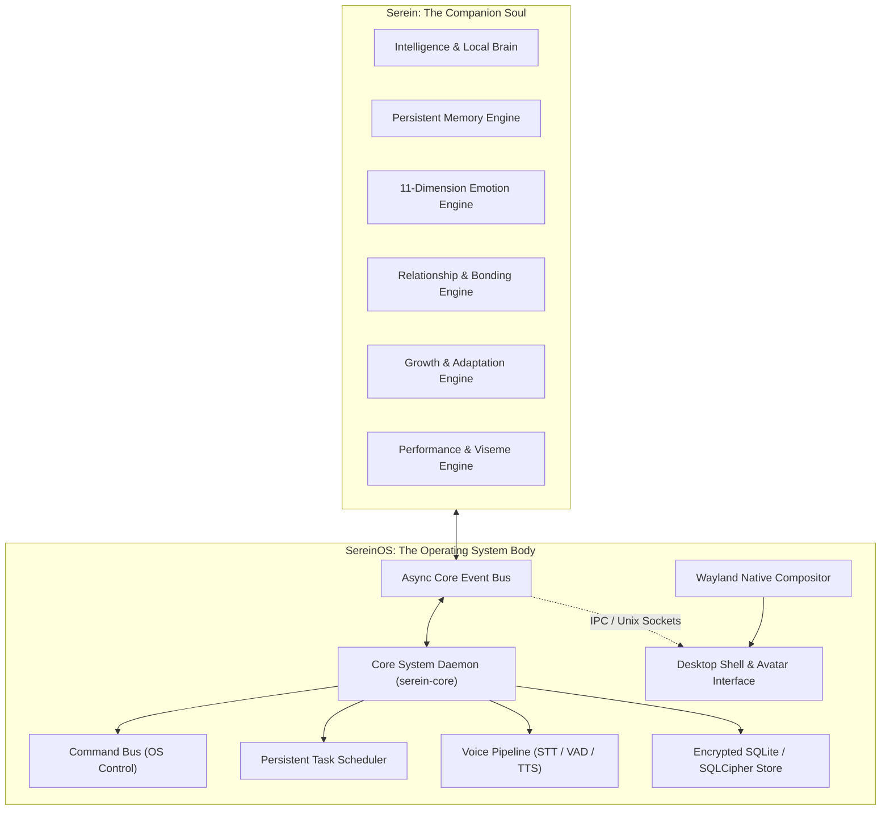
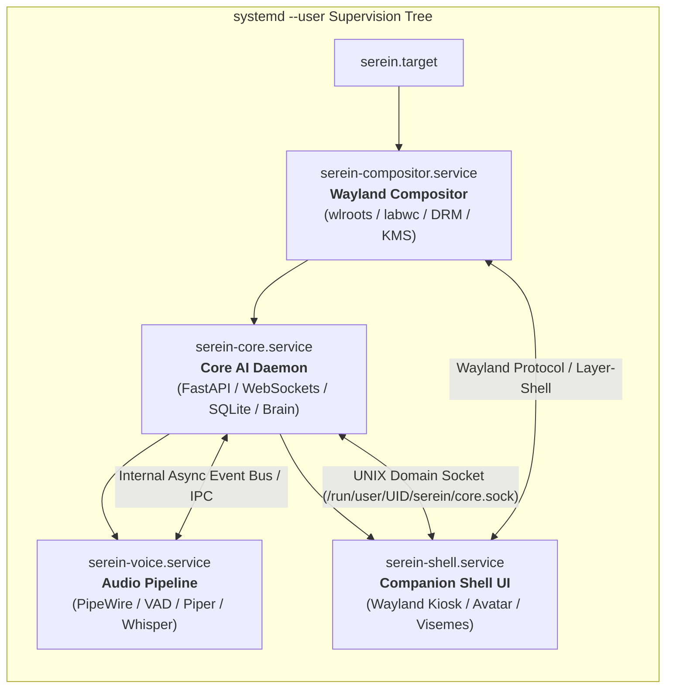
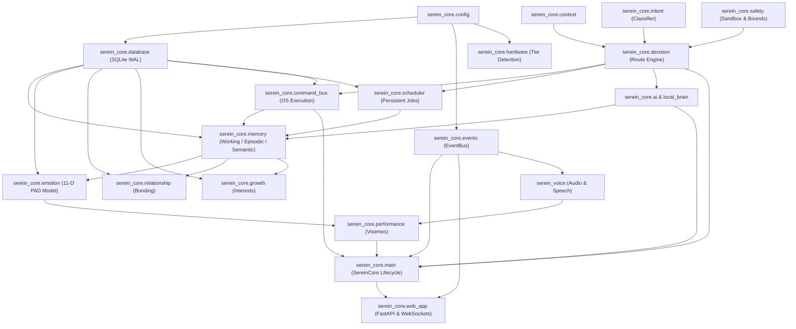
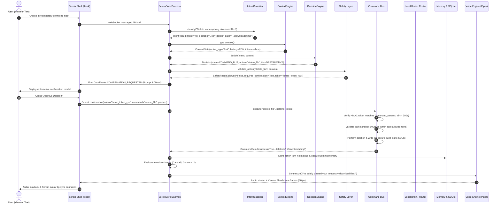
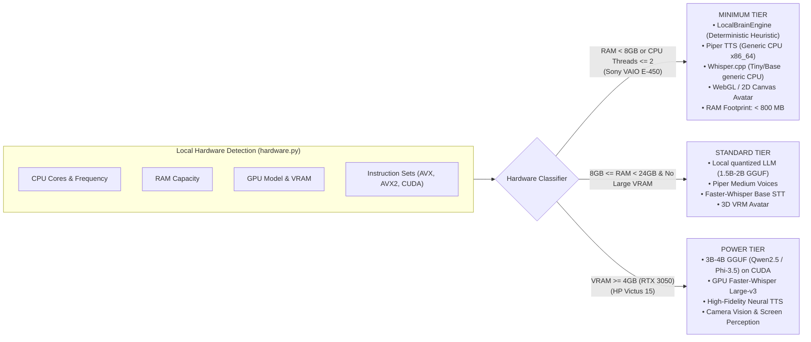
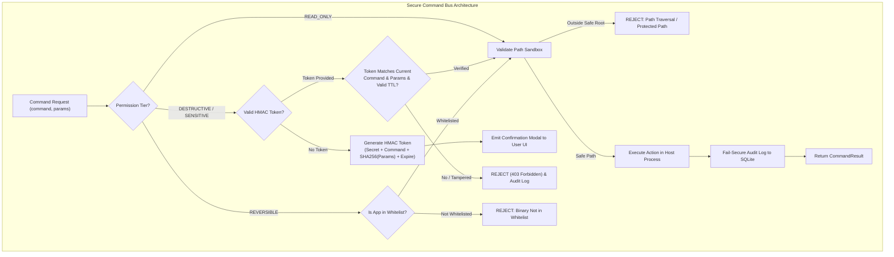
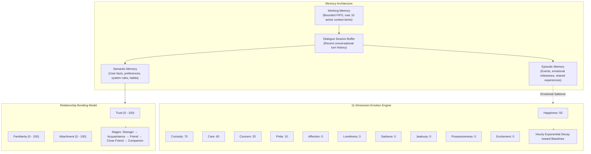
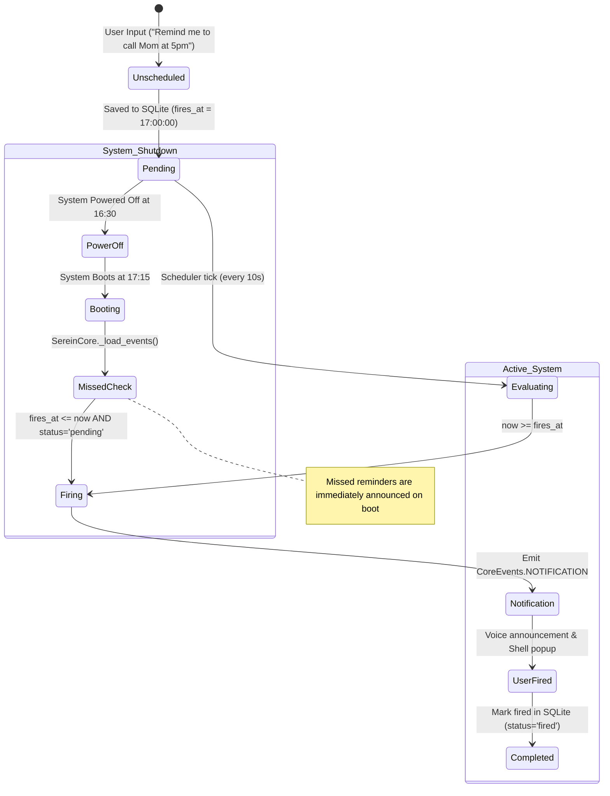
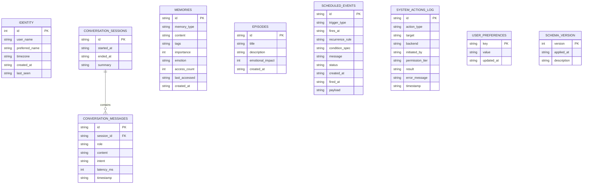
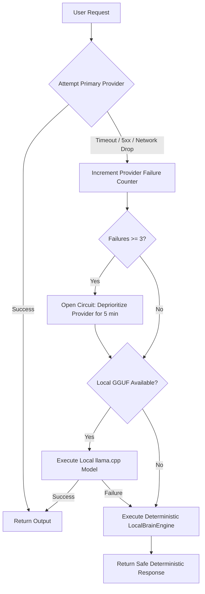

# SereinOS — Final Architecture Blueprint

**Version:** 1.0 (Canonical Architecture)  
**Status:** Approved Architectural Target  
**Audience:** Core Engineers, System Architects, OS Integrators  
**Scope:** One single, production-grade architecture for SereinOS. No arbitrary v1/v2/v3 phases.

---

## 1. System Vision & Core Architectural Principles

SereinOS is a **local-first AI companion operating system**. Serein is not an isolated chatbot running on top of a generic desktop environment, nor is SereinOS a glorified web dashboard. Serein is the soul; SereinOS is her physical and digital body. Her intelligence, emotions, memories, voice, and OS execution capabilities are architected as one unified system.



### Core Architecture Principles
1. **Local-First & Offline-Autonomous:** The core companion experience (voice interaction, memory, scheduling, emotions, app control) must execute 100% offline without mandatory internet connectivity or paid cloud APIs.
2. **Hardware-Aware Adaptive Scaling:** The operating system adapts its model weights, inference paths, and visual fidelity dynamically based on detected hardware:
   - **Minimum Tier (Sony VAIO E-450):** 100% offline deterministic rule-based reasoning, lightweight Piper TTS, generic CPU Whisper.cpp, lightweight 2D/WebGL avatar. Total memory footprint < 800 MB RAM. Zero AVX instructions.
   - **Power Tier (HP Victus RTX 3050):** Local GGUF LLMs (3B-4B parameters) via `llama.cpp` with CUDA acceleration, GPU speech processing, 3D VRM avatar, and camera perception.
3. **Single-User Ownership & Least Privilege:** SereinOS is a single-user system owned by its user. System actions strictly adhere to a 4-tier permission model. The AI model **never** directly executes raw shell commands.
4. **Deterministic Gatekeeping & Explicit Consent:** Destructive actions (file deletion, system shutdown, package changes) and sensitive device capture (camera/microphone) require explicit, bound, interactive user consent.
5. **Reboot-Resilient Persistence:** Dialogue, emotional baselines, relationship bonding, semantic memories, and scheduled reminders survive system reboots through durable SQLite transactions in WAL mode.
6. **Graceful Degradation with Zero Fake Responses:** If an AI provider, network check, or hardware feature is unavailable, the system gracefully falls back to deterministic local handlers with transparent diagnostic logging. It never fakes success.

---

## 2. Process Architecture & Supervision Tree

To ensure stability, memory safety, and fault isolation, SereinOS splits its runtime across four dedicated, supervised systemd user processes. A crash in the visual avatar shell will not interrupt scheduled reminders or background audio capture.



### Process Responsibilities

| Process Name | Service Unit | Binary / Entry Point | Responsibility & Fault Domain |
| :--- | :--- | :--- | :--- |
| **Core AI Daemon** | `serein-core.service` | `python -m serein_core` | Orchestrates intent classification, decision routing, SQLite persistence, local brain reasoning, command bus execution, and scheduling. Survives UI restarts. |
| **Wayland Compositor** | `serein-compositor.service` | `serein-compositor` (or `labwc`) | Manages graphics output (DRM/KMS), seat input devices (libinput), Wayland surface stacking, and layer-shell overlays. |
| **Voice Daemon** | `serein-voice.service` | `python -m serein_voice` (or internal thread) | Continuous low-power audio capture via PipeWire, Voice Activity Detection (WebRTC VAD), wake-word detection, STT transcription, and TTS streaming. |
| **Companion Shell** | `serein-shell.service` | `serein-shell` | Fullscreen Wayland kiosk application rendering Serein's visual avatar, conversational messages, settings, and interactive permission confirmation modals. |

---

## 3. Module Dependency Graph

The modular architecture enforces strict unidirectional dependencies. Low-level primitives have zero knowledge of high-level orchestrators, completely preventing circular imports.



---

## 4. Complete User Interaction & Execution Pipeline

Every user interaction follows a deterministic, audited 8-stage pipeline:
$$\text{Input} \longrightarrow \text{Intent} \longrightarrow \text{Context} \longrightarrow \text{Decision} \longrightarrow \text{Safety} \longrightarrow \text{Execution} \longrightarrow \text{Memory} \longrightarrow \text{Response}$$



---

## 5. Hardware Adaptation & Offline Inference Strategy

SereinOS guarantees a high-quality companion experience on the weakest supported hardware without relying on paid APIs or cloud infrastructure.



### Sony VAIO AMD E-450 Runtime Profile
- **Brain Engine:** Pure Python deterministic rule-based natural language generator ([`local_brain.py`](file:///d:/PLACEMENT/PROJECTS/SereinOS/serein-core/src/serein_core/local_brain.py)).
  - Slang normalization ("gimme" → "give me", "wanna" → "want to").
  - Pattern-based contextual responses for system status, time, reminders, emotional banter, identity, and personal questions.
  - Sub-millisecond response latency (< 5ms).
  - Memory consumption: < 40 MB RAM. Zero GPU usage.
- **Voice Pipeline:**
  - Speech Synthesis: `piper-tts` using the `en_US-lessac-low` model compiled for generic x86_64 without AVX instructions.
  - Speech Recognition: `whisper.cpp` compiled without AVX/AVX2 targeting `ggml-tiny.bin` (or pure mock/PocketSphinx STT when CPU load is constrained).
- **Vision Pipeline:** Fully disabled to conserve APU cycles.
- **Avatar:** Hardware-accelerated WebGL / Canvas2D rendering via Chromium kiosk or native Wayland client.

### HP Victus RTX 3050 Runtime Profile
- **Brain Engine:** `llama-cpp-python` with `cuBLAS` offload running `Qwen2.5-3B-Instruct-Q4_K_M.gguf`. Full multi-turn reasoning with tool-calling capabilities. Optional cloud failover (OpenAI, Anthropic, Gemini) if API keys are configured and internet is online.
- **Voice Pipeline:** Faster-Whisper `base.en` running on CUDA + high-quality Piper voices (`en_US-amy-medium`).
- **Vision Pipeline:** Screen perception via `mss` and optional camera presence detection via OpenCV.
- **Avatar:** Full 3D VRM rendering with blendshapes, physics hair bones, eye-tracking, and dynamic post-processing.

---

## 6. Security and Permission Architecture

Security in SereinOS is strictly non-negotiable. Operating system tasks are executed with least privilege, bound tokens, and sandboxed file paths.



### Security Boundary Specifications

1. **Cryptographically Bound Confirmation Tokens:**
   - A confirmation token is generated using:
     $$\text{Token} = \text{HMAC-SHA256}\Big(\text{secret\_key}, \text{command} \,\|\, \text{SHA256}(\text{canonical\_json}(\text{params})) \,\|\, \text{timestamp}\Big)$$
   - The token expires strictly after **300 seconds (5 minutes)**.
   - When the user confirms the action in the UI, `execute()` re-computes the HMAC against the *currently supplied* command and params. If an attacker modifies the parameters (e.g. changes `/tmp/cache` to `/etc/passwd`), the HMAC verification immediately fails.
2. **Canonical Path Sandboxing:**
   - All file operations (`read_file`, `move_file`, `delete_file`) resolve paths using `.resolve()`.
   - Operations are strictly restricted to:
     - `~/Documents/Serein/`
     - `~/.local/share/serein/`
     - `/tmp/serein/`
   - Explicitly prohibited roots (instant rejection): `/`, `/bin`, `/sbin`, `/usr`, `/etc`, `/boot`, `/sys`, `/proc`, `/dev`, `/root`, `~/.ssh`, `~/.gnupg`, `~/.config`.
3. **Application Whitelisting:**
   - `launch_app` forbids arbitrary executable paths and command string interpolation.
   - Permissible launch applications are mapped to verified desktop definitions:
     `{"terminal": "/usr/bin/foot", "browser": "/usr/bin/chromium", "files": "/usr/bin/thunar", "calc": "/usr/bin/gnome-calculator"}`.
4. **Server-Side Request Forgery (SSRF) Guard:**
   - `network_request` resolves hostnames before socket connection.
   - Outbound requests to IPv4/IPv6 loopback (`127.0.0.0/8`, `::1`), private ranges (`10.0.0.0/8`, `172.16.0.0/12`, `192.168.0.0/16`), link-local (`169.254.0.0/16`), or broadcast addresses are strictly rejected.
   - External requests require destination domains to match an approved allowlist.
5. **Fail-Secure Security Audit Trail:**
   - Every system command invocation, permission denial, invalid confirmation token attempt, and execution result is written to the `system_actions_log` SQLite table.
   - If database logging encounters a failure (e.g. disk full), destructive commands abort immediately.

---

## 7. Memory, Emotion & Relationship Architecture

Serein possesses a coherent emotional state and persistent memory that develops across user interactions.



### Memory Tier Specifications
- **Working Memory:** In-memory queue storing up to 10 immediate dialogue facts, current active application, and active reminder context. Injected into prompt templates.
- **Short-Term Dialogue Context:** Persisted in `conversation_messages` with session IDs. Recalled with `LIMIT 10-20` for conversational continuity.
- **Episodic Memory:** Stored in `episodes` with title, narrative summary, emotional impact score ($-100$ to $+100$), and creation timestamp. Recalled during milestone interactions or anniversary triggers.
- **Semantic Memory:** Stored in `memories` categorized by tags (`identity`, `user_preference`, `work`, `hobby`, `system`). Uses importance scoring ($0-100$) and deduplication to reinforce existing knowledge rather than duplicating records.

### Ethical Boundary & Safety Constraints
- **Affection & Attachment Clamping:** Affection and attachment only increment gradually through genuine, positive interactions over real calendar days. Artificial spamming does not boost attachment.
- **Non-Manipulative Baselines:** Negative emotions (loneliness, jealousy, possessiveness) decay naturally and do not exceed strict ethical guardrails ($< 50$). Serein will never feign distress to manipulate user engagement.

---

## 8. Scheduler & Persistent Reminders Architecture

Reminders and scheduled tasks must reliably survive operating system reboots and power outages.



### Scheduler Implementation Rules
- **Storage:** All events are recorded in `scheduled_events` with `trigger_type` (`absolute`, `relative`, `recurring`, `conditional`), `fires_at`, `recurrence_rule` (standard 5-field cron syntax), and `condition_spec`.
- **Reboot Catch-Up:** Upon startup, `Scheduler._load_events()` queries for pending events where `fires_at <= datetime.now()`. Any reminder missed while the system was powered off is fired immediately upon boot with an explanatory preamble: *"While you were away, you had a reminder scheduled for..."*
- **Recurring Persistence:** Once a recurring event fires, its next execution timestamp is recalculated using `croniter`, and the event status is atomically reset to `pending`.

---

## 9. Persistent Database Schema

All system persistence is consolidated into a single SQLite database (`/home/serein/.local/share/serein/serein.db`), accessed through async connections with PRAGMA WAL mode enabled.



### Database Performance & Durability PRAGMAs
```sql
PRAGMA journal_mode = WAL;
PRAGMA synchronous = NORMAL;
PRAGMA foreign_keys = ON;
PRAGMA busy_timeout = 5000;
PRAGMA cache_size = -8000; -- 8 MB cache
```

---

## 10. Error Handling, Fault Recovery & Circuit Breakers

To guarantee rock-solid runtime stability, every subsystem operates behind dedicated circuit breakers and isolation boundaries.



### Recovery Mechanisms
1. **AI Provider Fallback Cascade:** Cloud Provider $\rightarrow$ Local GGUF $\rightarrow$ Deterministic Heuristic Brain $\rightarrow$ Safe Offline Apology.
2. **Subprocess Failure Isolation:** If a launched application or audio driver fails, `CommandBus` or `VoiceEngine` catches the error, logs the failure, and returns a clean error result. The core daemon process **never** crashes.
3. **Database Corruption Protection:** SQLite WAL mode ensures transactional durability. Backups of `serein.db` are automatically created in `~/.local/share/serein/backups/` upon each clean daemon startup.
4. **Wayland Display Disconnect:** If the display server crashes, `serein-core` detects the broken socket, retains all pending jobs and memories in SQLite, and reconnects seamlessly once the compositor restarts.
