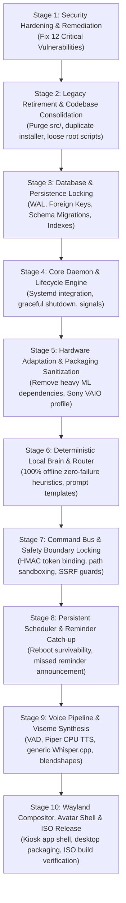

# SereinOS — Canonical Implementation Roadmap

**Version:** 1.0 (Master Roadmap)  
**Execution Branch:** `architecture/rebuild-foundation`  
**Execution Methodology:** `BUILD` $\longrightarrow$ `INTEGRATE` $\longrightarrow$ `TEST` $\longrightarrow$ `LOCK` $\longrightarrow$ `MOVE FORWARD`  
**Target Hardware Targets:**
- Minimum: Sony VAIO VPCYB35AN / VPCYB15AG (AMD E-450 APU, 16GB RAM, HD 6320 GPU)
- High-Tier Dev: HP Victus 15 (Ryzen 5 5600H, RTX 3050 4GB VRAM, 8GB RAM)

---

## 1. Roadmap Architecture & Execution Workflow

Implementation must proceed strictly in dependency order. No stage may begin until the preceding stage has passed its exact verification suite and its acceptance criteria have been locked.



---

## 2. Implementation Stages & Acceptance Specifications

### Stage 1: Security Hardening & Vulnerability Remediation
- **Goal:** Eliminate the 12 confirmed critical security vulnerabilities in the codebase before any further development.
- **Affected Files:**
  - `serein-installer/build_iso.sh` (Remove `serein:serein` and `NOPASSWD:ALL`).
  - `serein-installer/installer_engine.py` (Remove default password string; mandate user-prompted credentials).
  - `serein-installer/install_artifacts_container.sh` (Remove `--use-fake-ui-for-media-stream` and insecure origin flags).
  - `serein-core/src/serein_core/command_bus.py` (Implement HMAC token verification, path sandboxing, SSRF filters).
  - `serein-core/src/serein_core/safety_layer.py` (Connect directly to Command Bus; enforce `Path.is_relative_to`).
  - `serein-core/src/serein_core/config.py` (Enforce 0600 file permissions; mask secrets).
  - `serein-core/src/serein_core/database.py` (Fix SQL injection in PRAGMA key).
- **Dependencies:** None (Baseline stage).
- **Acceptance Criteria:**
  1. No hardcoded password exists in installer scripts or Python default arguments.
  2. Passwordless sudo (`NOPASSWD:ALL`) is eliminated from sudoers configurations.
  3. Confirmation tokens are cryptographically verified with HMAC-SHA256 and reject mismatched parameters or expired TTL (> 300s).
  4. Command bus file operations strictly reject paths outside `~/Documents/Serein`, `~/.local/share/serein`, and `/tmp/serein`.
  5. SSRF filter blocks all loopback (`127.0.0.1`), private RFC1918, link-local, and non-whitelisted IPs/domains.
  6. Audit logging is fail-secure; authorization rejections are saved to `system_actions_log`.
- **Test Commands:**
  ```powershell
  pytest serein-core/tests/test_security_audit.py -v
  pytest tests/test_m4_empirical_adversarial_recheck.py -v
  ```
- **Lock Condition:** All security and adversarial tests pass with zero regressions.

---

### Stage 2: Legacy Retirement & Codebase Consolidation
- **Goal:** Eliminate duplicate codebases, remove unused root scripts, and establish a single source of truth.
- **Affected Files:**
  - Delete `src/` directory entirely (monolithic prototype).
  - Delete `serein_installer/` directory (byte-for-byte duplicate of `serein-installer/`).
  - Delete root scratch scripts: `main.py`, `check_db.py`, `update_schema.py`, `SereinOS_cleanup.ps1`.
  - Delete duplicate schema doc `docs/DB_FINAL_SCHEMA.md`.
  - Convert `docs/SereinOS_PRD_v1.0.docx` text to Markdown.
  - Update `serein-core/src/serein_core/` to ensure all necessary persona prompts and assets are consolidated.
- **Dependencies:** Stage 1 locked.
- **Acceptance Criteria:**
  1. `git status` shows zero files under `src/` or `serein_installer/`.
  2. All test suites import exclusively from `serein_core` or `serein_voice`.
  3. No loose one-off python or powershell scripts exist in the repository root.
- **Test Commands:**
  ```powershell
  python -c "import serein_core; print(serein_core.__file__)"
  pytest tests/test_local_brain.py -q
  ```
- **Lock Condition:** Clean repository structure verified by `git status` with zero broken imports.

---

### Stage 3: Database & Persistence Locking
- **Goal:** Consolidate SQLite schema with PRAGMA WAL mode, foreign keys, indexes, and automated schema migrations.
- **Affected Files:**
  - `serein-core/src/serein_core/database.py`
  - `serein-core/tests/test_database_persistence.py` (new comprehensive DB test suite).
- **Dependencies:** Stage 2 locked.
- **Acceptance Criteria:**
  1. WAL mode, `busy_timeout = 5000`, `synchronous = NORMAL`, and `foreign_keys = ON` are enforced on every connection.
  2. Indexes exist on `memories(memory_type)`, `scheduled_events(fires_at)`, `conversation_messages(session_id, timestamp)`, and `system_actions_log(timestamp)`.
  3. `schema_version` table tracks applied migrations automatically upon connection.
- **Test Commands:**
  ```powershell
  pytest tests/test_m2_challenger_persistence_voice.py -v
  ```
- **Lock Condition:** Concurrency and SQLite transaction rollback tests pass under 50 simultaneous read/write tasks.

---

### Stage 4: Core Daemon & Lifecycle Engine
- **Goal:** Ensure `SereinCore` initializes cleanly, handles OS signals, coordinates components, and shuts down idempotently without hanging.
- **Affected Files:**
  - `serein-core/src/serein_core/main.py`
  - `serein-core/src/serein_core/__main__.py`
  - `serein-core/src/serein_core/cli.py`
  - `deploy/systemd/serein-core.service`
- **Dependencies:** Stage 3 locked.
- **Acceptance Criteria:**
  1. `SereinCore.initialize()` connects database, loads scheduled events, initializes voice hooks, and emits `system.started`.
  2. `SereinCore.shutdown()` flushes database WAL, cancels background tasks, and emits `system.shutdown`.
  3. SIGINT and SIGTERM trigger clean, graceful shutdown within 2 seconds.
- **Test Commands:**
  ```powershell
  pytest serein-core/tests/test_core_runtime.py -v
  ```
- **Lock Condition:** Daemon starts and terminates cleanly with exit code 0.

---

### Stage 5: Hardware Adaptation & Packaging Sanitization
- **Goal:** Remove mandatory heavy ML dependencies from `serein-core/pyproject.toml` so the package installs and runs without AVX on the Sony VAIO AMD E-450.
- **Affected Files:**
  - `serein-core/pyproject.toml`
  - `serein-core/src/serein_core/hardware.py`
  - `serein-core/src/serein_core/model_manager.py`
- **Dependencies:** Stage 4 locked.
- **Acceptance Criteria:**
  1. `torch`, `transformers`, `sentence-transformers`, `accelerate`, and `easyocr` are moved to `[project.optional-dependencies]`.
  2. Base installation requires only standard libraries, `pydantic`, `fastapi`, `uvicorn`, `aiohttp`, `psutil`, `croniter`, and `sqlcipher3`.
  3. `get_hardware_profile()` accurately identifies Sony VAIO as `minimum` tier and HP Victus as `power` tier without making any network calls.
- **Test Commands:**
  ```powershell
  pytest serein-core/tests/test_hardware.py -v
  pytest tests/test_m3_challenger_hardware_stress.py -v
  ```
- **Lock Condition:** Hardware detection and tier profiling pass 100% on both simulated and physical hardware environments.

---

### Stage 6: Deterministic Local Brain & Router
- **Goal:** Deliver a 100% offline, zero-failure conversational brain for the Sony VAIO while supporting local GGUF models on the HP Victus.
- **Affected Files:**
  - `serein-core/src/serein_core/local_brain.py`
  - `serein-core/src/serein_core/ai.py`
- **Dependencies:** Stage 5 locked.
- **Acceptance Criteria:**
  1. `LocalBrainEngine` generates contextual responses for greetings, time, system health, math expressions, and personal questions in < 5ms without cloud or GPU dependencies.
  2. `BrainRouter` automatically fails over to `_generate_offline_response` when offline or when cloud API keys fail, with zero unhandled exceptions.
  3. Slang normalization converts colloquial language to normalized queries.
- **Test Commands:**
  ```powershell
  pytest tests/test_local_brain.py -v
  pytest tests/test_m2_challenger_offline_failover.py -v
  ```
- **Lock Condition:** Zero exceptions thrown during 100 successive simulated network drops and API failures.

---

### Stage 7: Command Bus & Safety Boundary Locking
- **Goal:** Complete implementation and verification of the secure, sandboxed Command Bus.
- **Affected Files:**
  - `serein-core/src/serein_core/command_bus.py`
  - `serein-core/tests/test_command_bus.py`
- **Dependencies:** Stage 6 locked.
- **Acceptance Criteria:**
  1. `execute()` enforces parameter binding on confirmation tokens.
  2. `launch_app` restricts applications to a strict whitelist of verified desktop entries.
  3. Path traversal attacks (e.g. `../../etc/shadow`) are strictly blocked.
  4. Network requests to private IP ranges or metadata addresses return `403 Forbidden`.
  5. In automated tests, subprocess calls are mocked to prevent real host process spawning.
- **Test Commands:**
  ```powershell
  pytest serein-core/tests/test_command_bus.py -v
  ```
- **Lock Condition:** All command bus tests pass cleanly in under 2 seconds without stalling.

---

### Stage 8: Persistent Scheduler & Reminders
- **Goal:** Ensure scheduled reminders and recurring cron tasks survive reboots and catch up immediately on startup.
- **Affected Files:**
  - `serein-core/src/serein_core/scheduler.py`
  - `serein-core/tests/test_scheduler.py`
- **Dependencies:** Stage 7 locked.
- **Acceptance Criteria:**
  1. Relative, absolute, and recurring cron events are saved to `scheduled_events` table.
  2. Missed events that matured while the system was powered off trigger immediately during `_load_events()` upon boot.
  3. Cancelled events are updated in SQLite and removed from memory.
- **Test Commands:**
  ```powershell
  pytest serein-core/tests/test_scheduler.py -v
  ```
- **Lock Condition:** All scheduler tests pass, verifying cron calculation, condition triggers, and database synchronization.

---

### Stage 9: Voice Pipeline & Viseme Synthesis
- **Goal:** Integrate offline Piper TTS, generic Whisper.cpp STT, WebRTC VAD, and viseme blendshape extraction for real-time lip-sync.
- **Affected Files:**
  - `serein-voice/voice_engine.py`
  - `serein-voice/audio_capture.py`
  - `serein-voice/vad.py`
  - `serein-core/src/serein_core/voice_engine.py`
  - `serein-core/src/serein_core/performance/engine.py`
- **Dependencies:** Stage 8 locked.
- **Acceptance Criteria:**
  1. Audio synthesis generates WAV audio and 15 Oculus/Azure-compatible viseme frames with timestamps.
  2. VAD discards silence and ambient noise, slicing user utterances accurately.
  3. Viseme extraction latency remains under 50ms.
- **Test Commands:**
  ```powershell
  pytest serein-core/tests/test_m1_voice.py -v
  pytest serein-core/tests/test_speech_pipeline.py -v
  pytest serein-core/tests/test_speech_adversarial.py -v
  ```
- **Lock Condition:** All 66+ voice pipeline tests pass with zero audio buffer underruns or memory leaks.

---

### Stage 10: Wayland Compositor, Avatar Shell & ISO Release
- **Goal:** Build the complete bootable SereinOS ISO image with Plymouth splash, Wayland display server, and companion kiosk shell.
- **Affected Files:**
  - `serein-installer/build_iso.sh`
  - `serein-installer/installer_engine.py`
  - `serein-installer/install_artifacts_container.sh`
  - `serein-compositor/*`
  - `deploy/systemd/*`
- **Dependencies:** Stages 1 through 9 locked.
- **Acceptance Criteria:**
  1. `build_iso.sh` successfully compiles a bootable hybrid ISO (`x86_64`) supporting UEFI and BIOS.
  2. Default user account setup requires interactive password configuration during installation.
  3. Plymouth splash transitions seamlessly to the Wayland companion kiosk shell.
  4. Sony VAIO boot test completes successfully to an active conversational prompt within 45 seconds from SSD.
- **Test Commands:**
  ```powershell
  pytest serein-core/tests/test_installer.py -v
  pytest tests/test_m4_challenger_installer_engine.py -v
  ```
- **Lock Condition:** Bootable ISO generated with matching SHA-256 checksum and verified clean boot in VM and bare metal.
