# SereinOS — Canonical Implementation Roadmap

**Version:** 2.0 (Authoritative Non-Destructive Migration Roadmap)  
**Execution Branch:** `architecture/rebuild-foundation`  
**Core Methodology:** Non-destructive progressive implementation (`BUILD` $\longrightarrow$ `INTEGRATE` $\longrightarrow$ `VERIFY` $\longrightarrow$ `LOCK` $\longrightarrow$ `RETIRE LEGACY`). Legacy components are never deleted until modern replacements are verified against the full regression suite.  
**Target Hardware Targets:**
- **Minimum Target:** Sony VAIO VPCYB35AN / VPCYB15AG (AMD E-450 APU 1.65 GHz, 16GB DDR3 RAM, 256GB SATA SSD, AMD Radeon HD 6320 GPU, Zero AVX/AVX2)
- **High-Tier Dev Target:** HP Victus 15 (AMD Ryzen 5 5600H, NVIDIA GeForce RTX 3050 Laptop GPU 4GB VRAM, 8GB DDR4 RAM, 512GB NVMe SSD)

---

## 1. Roadmap Architecture & Execution Workflow

Implementation must proceed strictly in dependency order. No stage may begin until the preceding stage has passed its exact verification suite, security constraints, and objective lock criteria.

```mermaid
flowchart TD
    S1["Stage 1: Security Hardening & Pre-Flight Remediation<br/>(Fix 12 Critical Vulnerabilities, Credentials, Sudo, Secrets)"]
    S2["Stage 2: Database & Persistence Layer Lockdown<br/>(Authoritative SQLite WAL, Migrations, pending_challenges)"]
    S3["Stage 3: Core Daemon Lifecycle, UNIX Socket IPC & Command Bus<br/>(Single-use Challenges, Trash Redirection, SSRF IP Pinning, Mocking)"]
    S4["Stage 4: Hardware Adaptation & Packaging Sanitization<br/>(Move heavy ML to optional, VAIO AVX-free profile)"]
    S5["Stage 5: Cognitive Engine Consolidation<br/>(Offline Heuristics Brain, Memory Tiers, Emotion Decay, Scheduler Catch-up)"]
    S6["Stage 6: Voice Pipeline Consolidation & Viseme Synchronization<br/>(In-Process Voice Worker, Piper CPU, Whisper.cpp, Visemes)"]
    S7["Stage 7: Wayland Compositor (labwc), Kiosk Shell & Native Avatar<br/>(labwc layer-shell, Chromium Kiosk, WebGL/2D Avatar)"]
    S8["Stage 8: Comprehensive End-to-End Verification & Subsystem Validation<br/>(Full 808-test unified run, Contract & Threat validation)"]
    S9["Stage 9: Legacy Retirement & Codebase Consolidation<br/>(Safe purge of src/, duplicate installer, scratch scripts)"]
    S10["Stage 10: Systemd Packaging, Live Installer & Bootable ISO Validation<br/>(systemd --user units, build_iso.sh, Plymouth, Bare-Metal Boot)"]

    S1 --> S2 --> S3 --> S4 --> S5 --> S6 --> S7 --> S8 --> S9 --> S10
```



---

## 2. Detailed Implementation Stages

### Stage 1: Security Hardening & Pre-Flight Remediation [LOCKED - COMPLETED]
- **Goal:** Eliminate the 12 confirmed critical security vulnerabilities in installer scripts, sudoers configuration, file permissions, Command Bus execution, path containment, and SQL string pragmas before any architectural modifications begin.
- **Status:** **LOCKED & VERIFIED** (All 12 vulnerabilities remediated and validated under dedicated adversarial tests).
- **Affected Files:**
  - [`serein-installer/build_iso.sh`](file:///d:/PLACEMENT/PROJECTS/SereinOS/serein-installer/build_iso.sh) (Remove hardcoded credentials `serein:serein`; remove passwordless sudo `NOPASSWD:ALL`).
  - [`serein-installer/installer_engine.py`](file:///d:/PLACEMENT/PROJECTS/SereinOS/serein-installer/installer_engine.py) (Remove default password string; enforce user-prompted credentials with minimum length $\ge 8$ and complexity).
  - [`serein-installer/install_artifacts_container.sh`](file:///d:/PLACEMENT/PROJECTS/SereinOS/serein-installer/install_artifacts_container.sh) (Remove `--use-fake-ui-for-media-stream` and insecure origin bypass flags).
  - [`serein-core/src/serein_core/config.py`](file:///d:/PLACEMENT/PROJECTS/SereinOS/serein-core/src/serein_core/config.py) (Enforce `0600` permissions on config files and `0700` on directories; mask secrets in serialization; fix Pydantic v2 `ConfigDict` deprecation warnings).
  - [`serein-core/src/serein_core/database.py`](file:///d:/PLACEMENT/PROJECTS/SereinOS/serein-core/src/serein_core/database.py) (Fix SQL injection in `PRAGMA key` via validation and string escaping).
  - [`serein-core/src/serein_core/safety_layer.py`](file:///d:/PLACEMENT/PROJECTS/SereinOS/serein-core/src/serein_core/safety_layer.py) (Implement canonical `Path.resolve()` containment checking using `Path.is_relative_to()`; prevent auto-granting permissions).
  - [`serein-core/src/serein_core/command_bus.py`](file:///d:/PLACEMENT/PROJECTS/SereinOS/serein-core/src/serein_core/command_bus.py) (Enforce application whitelist; integrate SafetyLayer; implement Freedesktop Trash redirection; implement server-tracked single-use confirmation challenges; SSRF protection; fail-secure audit logging).
  - [`serein-core/src/serein_core/self_evolution.py`](file:///d:/PLACEMENT/PROJECTS/SereinOS/serein-core/src/serein_core/self_evolution.py) (Enforce repository containment on patch application; ban absolute paths).
  - [`serein-core/src/serein_core/agent_sandbox.py`](file:///d:/PLACEMENT/PROJECTS/SereinOS/serein-core/src/serein_core/agent_sandbox.py) (Raise `PermissionError` when container isolation is missing, preventing direct host execution).
  - [`serein-core/src/serein_core/web_app.py`](file:///d:/PLACEMENT/PROJECTS/SereinOS/serein-core/src/serein_core/web_app.py) (Remove hardcoded default password from API models and installer handlers).
  - [`serein-core/tests/test_stage1_security_adversarial.py`](file:///d:/PLACEMENT/PROJECTS/SereinOS/serein-core/tests/test_stage1_security_adversarial.py) (19 dedicated adversarial test cases covering all 12 vulnerabilities).
- **Remediation Summary:**
  1. **V1 (Default Credentials):** **FIXED AND TESTED**
  2. **V2 (NOPASSWD:ALL Sudo):** **FIXED AND TESTED**
  3. **V3 (Auto-Granted Permissions):** **FIXED AND TESTED**
  4. **V4 (Unbound Confirmation Tokens):** **FIXED AND TESTED**
  5. **V5 (Bypassed Safety Layer):** **FIXED AND TESTED**
  6. **V6 (Browser Media Consent Bypass):** **FIXED AND TESTED**
  7. **V7 (Arbitrary File Deletion / Traversal):** **FIXED AND TESTED**
  8. **V8 (SSRF / DNS Rebinding):** **FIXED AND TESTED**
  9. **V9 (Arbitrary App Launch / Shell Injection):** **FIXED AND TESTED**
  10. **V10 (Unrestricted Self-Evolution / Host Escape):** **FIXED AND TESTED**
  11. **V11 (Secrets in Plaintext / PRAGMA SQLi):** **FIXED AND TESTED**
  12. **V12 (Silent Audit Log Suppression):** **FIXED AND TESTED**
- **Dependencies:** None (Baseline pre-flight stage).
- **Acceptance Criteria:**
  1. No default or hardcoded password exists anywhere in `build_iso.sh`, `installer_engine.py`, or `web_app.py`.
  2. Sudoers file in ISO build does not grant `NOPASSWD:ALL`.
  3. Browser kiosk launch script does not include `--use-fake-ui-for-media-stream`.
  4. Configuration file writing sets POSIX file mode to `0600` (read/write by owner only).
  5. PRAGMA key operations safely quote or validate encryption keys to prevent SQL injection.
  6. All 12 critical vulnerabilities verified remediated with 0 regressions.
- **Test Commands & Results:**
  ```powershell
  pytest serein-core/tests/test_stage1_security_adversarial.py -v   # 18 passed, 1 skipped (0.71s)
  pytest tests/test_m4_empirical_adversarial_recheck.py -v          # 36 passed (1.93s)
  pytest serein-core/tests/test_security_audit.py -v                # 7 passed (3.11s)
  pytest serein-core/tests/test_command_bus.py -v                   # 10 passed (0.96s)
  pytest serein-core/tests/test_m2_brain.py -v                      # 18 passed (1.97s)
  ```
- **Rollback Strategy:** `git checkout HEAD -- serein-installer/ serein-core/`
- **Lock Condition:** All security audit and adversarial assertions pass; zero plaintext default credentials or unescaped pragmas detected by static scans; fail-secure behavior verified. Stage 1 is officially **LOCKED**.

---

### Stage 2: Database & Persistence Layer Lockdown
- **Goal:** Lock `serein_core.database` as the sole authoritative persistence layer, enforcing WAL mode, foreign keys, schema migrations, and adding the `pending_challenges` table.
- **Affected Files:**
  - [`serein-core/src/serein_core/database.py`](file:///d:/PLACEMENT/PROJECTS/SereinOS/serein-core/src/serein_core/database.py) (Add `pending_challenges` table schema, add indexes, enforce PRAGMA connection hooks).
  - [`serein-core/tests/test_database_persistence.py`](file:///d:/PLACEMENT/PROJECTS/SereinOS/serein-core/tests/test_database_persistence.py) (Comprehensive concurrency and migration tests).
- **Dependencies:** Stage 1 locked.
- **Acceptance Criteria:**
  1. Every database connection automatically executes `PRAGMA journal_mode = WAL`, `PRAGMA synchronous = NORMAL`, `PRAGMA foreign_keys = ON`, and `PRAGMA busy_timeout = 5000`.
  2. `pending_challenges` table created with columns `(challenge_id PK, session_id, command, param_hash, expires_at, status, created_at, consumed_at)`.
  3. Indexes exist on `scheduled_events(fires_at)`, `conversation_messages(session_id, timestamp)`, `memories(memory_type)`, `system_actions_log(timestamp)`, and `pending_challenges(challenge_id, session_id)`.
  4. Automatic migration runner seamlessly handles legacy schema versions without data loss.
- **Test Commands:**
  ```powershell
  pytest serein-core/tests/test_database_persistence.py -v
  pytest tests/test_m2_challenger_persistence_voice.py -k "test_db or test_persistence" -v
  ```
- **Rollback Strategy:** `git checkout HEAD -- serein-core/src/serein_core/database.py serein-core/tests/test_database_persistence.py`
- **Lock Condition:** Concurrency test with 50 simultaneous asynchronous read/write tasks succeeds with zero `database is locked` exceptions and 100% data integrity.

---

### Stage 3: Core Daemon Lifecycle, UNIX Socket IPC & Command Bus
- **Goal:** Complete implementation and verification of the secure Command Bus with server-tracked single-use confirmation challenges, Freedesktop Trash redirection, application whitelisting, SSRF socket-level IP pinning, and mock subprocess handling to prevent test runner stalls.
- **Affected Files:**
  - [`serein-core/src/serein_core/command_bus.py`](file:///d:/PLACEMENT/PROJECTS/SereinOS/serein-core/src/serein_core/command_bus.py) (Single-use challenge consumption, Trash redirection via `gio trash`/`send2trash`, application whitelist, SSRF socket pinning).
  - [`serein-core/src/serein_core/main.py`](file:///d:/PLACEMENT/PROJECTS/SereinOS/serein-core/src/serein_core/main.py) (Daemon lifecycle, signal handlers, UNIX domain socket IPC listener at `/run/user/<UID>/serein/core.sock`, session token auth).
  - [`serein-core/tests/test_command_bus.py`](file:///d:/PLACEMENT/PROJECTS/SereinOS/serein-core/tests/test_command_bus.py) (Unit tests for sandbox, challenges, whitelist, SSRF).
  - [`serein-core/tests/test_m2_brain.py`](file:///d:/PLACEMENT/PROJECTS/SereinOS/serein-core/tests/test_m2_brain.py) (Mock `create_subprocess_exec` at line 309 to prevent live host subprocess spawns).
- **Dependencies:** Stage 2 locked.
- **Acceptance Criteria:**
  1. Confirmation challenges are tracked in SQLite, expire in 300s, check `param_hash = SHA256(canonical_json(params))`, and are atomically consumed (`status='consumed'`). Replay attempts are rejected.
  2. File deletion in user workspaces (`~/Documents`, `~/Downloads`, `~/Desktop`) redirects to Freedesktop Trash (`~/.local/share/Trash`). Hard deletion is forbidden outside `/tmp/serein/`.
  3. `launch_app` permits only verified applications from the application whitelist. Arbitrary binary paths and shell command interpolation are rejected.
  4. Network requests resolve DNS pre-flight and reject loopback, link-local, and private RFC1918 CIDRs. Outbound sockets are pinned directly to the pre-validated IP to eliminate DNS rebinding.
  5. Audit logging is fail-secure; failures abort sensitive command execution.
  6. Subprocess spawning in tests is cleanly mocked; `test_m2_brain.py` executes without deadlocking the runner.
- **Test Commands:**
  ```powershell
  pytest serein-core/tests/test_command_bus.py -v
  pytest serein-core/tests/test_m2_brain.py -v
  ```
- **Rollback Strategy:** `git checkout HEAD -- serein-core/src/serein_core/command_bus.py serein-core/src/serein_core/main.py serein-core/tests/`
- **Lock Condition:** All command bus unit tests pass in < 3 seconds; all security adversarial tests in `tests/test_m4_empirical_adversarial_recheck.py` pass.

---

### Stage 4: Hardware Adaptation & Packaging Sanitization
- **Goal:** Move heavy ML packages (`torch`, `transformers`, `sentence-transformers`, `accelerate`, `easyocr`, `opencv-python-headless`) to optional dependencies in `serein-core/pyproject.toml`, ensuring the package installs and runs without AVX on the Sony VAIO AMD E-450.
- **Affected Files:**
  - [`serein-core/pyproject.toml`](file:///d:/PLACEMENT/PROJECTS/SereinOS/serein-core/pyproject.toml) (Move heavy ML dependencies to `[project.optional-dependencies]`).
  - [`serein-core/src/serein_core/hardware.py`](file:///d:/PLACEMENT/PROJECTS/SereinOS/serein-core/src/serein_core/hardware.py) (Hardware detection, AVX instruction validation, tier assignment).
  - [`serein-core/src/serein_core/model_manager.py`](file:///d:/PLACEMENT/PROJECTS/SereinOS/serein-core/src/serein_core/model_manager.py) (Fallback planning: deterministic heuristic for `minimum`, GGUF/CUDA for `power`).
- **Dependencies:** Stage 3 locked.
- **Acceptance Criteria:**
  1. Base installation of `serein-core` contains zero PyTorch, torchvision, or CUDA binary dependencies.
  2. Hardware detection accurately profiles AMD E-450 as `minimum` tier and HP Victus as `power` tier using local `/proc/cpuinfo` and `sysfs` parsing.
  3. No AVX instructions are executed when running on `minimum` tier.
  4. Memory footprint of base daemon remains strictly under 150 MB RAM idle.
- **Test Commands:**
  ```powershell
  pytest serein-core/tests/test_hardware.py -v
  pytest tests/test_m3_challenger_hardware_stress.py -v
  ```
- **Rollback Strategy:** `git checkout HEAD -- serein-core/pyproject.toml serein-core/src/serein_core/hardware.py serein-core/src/serein_core/model_manager.py`
- **Lock Condition:** Package builds and installs cleanly in an isolated virtual environment without building native PyTorch C-extensions.

---

### Stage 5: Cognitive Engine Consolidation (Local Brain, Memory, Emotion, Relationship, Scheduler)
- **Goal:** Unify and harden the cognitive engines in `serein_core` (Local Brain heuristics, working memory, episodic/semantic storage, 11-dimension emotion decay, relationship bonding, and persistent scheduler reboot catch-up).
- **Affected Files:**
  - [`serein-core/src/serein_core/local_brain.py`](file:///d:/PLACEMENT/PROJECTS/SereinOS/serein-core/src/serein_core/local_brain.py) (Deterministic heuristic NLG, slang normalization).
  - [`serein-core/src/serein_core/ai.py`](file:///d:/PLACEMENT/PROJECTS/SereinOS/serein-core/src/serein_core/ai.py) (BrainRouter with zero-crash offline fallback).
  - [`serein-core/src/serein_core/memory.py`](file:///d:/PLACEMENT/PROJECTS/SereinOS/serein-core/src/serein_core/memory.py) (Bounded FIFO working memory, importance scoring, SQLite persistence).
  - [`serein-core/src/serein_core/emotion.py`](file:///d:/PLACEMENT/PROJECTS/SereinOS/serein-core/src/serein_core/emotion.py) (11-D PAD model, hourly decay toward baselines).
  - [`serein-core/src/serein_core/relationship.py`](file:///d:/PLACEMENT/PROJECTS/SereinOS/serein-core/src/serein_core/relationship.py) (Bonding stages: Stranger to Companion).
  - [`serein-core/src/serein_core/growth.py`](file:///d:/PLACEMENT/PROJECTS/SereinOS/serein-core/src/serein_core/growth.py) (Domain interest tracking).
  - [`serein-core/src/serein_core/scheduler.py`](file:///d:/PLACEMENT/PROJECTS/SereinOS/serein-core/src/serein_core/scheduler.py) (Reboot catch-up for missed reminders, cron recurrence).
- **Dependencies:** Stage 4 locked.
- **Acceptance Criteria:**
  1. `LocalBrainEngine` generates contextual responses for system queries, time, reminders, greetings, and personal banter in < 5ms without cloud or GPU dependencies.
  2. `BrainRouter` automatically fails over to `_generate_offline_response` when offline or when cloud API keys fail, with zero unhandled exceptions.
  3. Working memory holds at most 10 active items; older items are evicted or consolidated into SQLite `memories`.
  4. Emotional state decays toward baseline over simulated 24-hour periods; affection increments are clamped to prevent manipulation.
  5. Missed reminders that matured while the system was powered off trigger immediately during startup with an explanatory preamble.
- **Test Commands:**
  ```powershell
  pytest tests/test_local_brain.py -v
  pytest serein-core/tests/test_scheduler.py -v
  pytest serein-core/tests/test_m2_brain.py -v
  pytest tests/test_m2_challenger_offline_failover.py -v
  ```
- **Rollback Strategy:** `git checkout HEAD -- serein-core/src/serein_core/local_brain.py serein-core/src/serein_core/ai.py serein-core/src/serein_core/memory.py serein-core/src/serein_core/emotion.py serein-core/src/serein_core/relationship.py serein-core/src/serein_core/growth.py serein-core/src/serein_core/scheduler.py`
- **Lock Condition:** 100 consecutive simulated offline interactions and failover tests pass with zero exceptions.

---

### Stage 6: Voice Pipeline Consolidation & Viseme Synchronization
- **Goal:** Consolidate `serein-voice/` audio pipeline into `serein_core` as an in-process background worker thread, ensuring zero-copy PCM audio buffer exchange and 60fps viseme blendshape generation.
- **Affected Files:**
  - [`serein-voice/voice_engine.py`](file:///d:/PLACEMENT/PROJECTS/SereinOS/serein-voice/voice_engine.py)
  - [`serein-voice/audio_capture.py`](file:///d:/PLACEMENT/PROJECTS/SereinOS/serein-voice/audio_capture.py)
  - [`serein-voice/vad.py`](file:///d:/PLACEMENT/PROJECTS/SereinOS/serein-voice/vad.py)
  - [`serein-core/src/serein_core/voice_engine.py`](file:///d:/PLACEMENT/PROJECTS/SereinOS/serein-core/src/serein_core/voice_engine.py)
  - [`serein-core/src/serein_core/performance/engine.py`](file:///d:/PLACEMENT/PROJECTS/SereinOS/serein-core/src/serein_core/performance/engine.py)
- **Dependencies:** Stage 5 locked.
- **Acceptance Criteria:**
  1. Piper TTS runs on CPU x86_64 generating 16kHz WAV audio and 15 Oculus-compatible viseme frames with millisecond timestamps.
  2. WebRTC VAD accurately slices voice audio, suppressing ambient noise and silence.
  3. `VoiceEngine` worker thread passes audio buffers to `serein-core` via internal asyncio queues with zero IPC serialization latency.
  4. Viseme extraction latency remains under 50ms.
- **Test Commands:**
  ```powershell
  pytest serein-core/tests/test_m1_voice.py -v
  pytest serein-core/tests/test_speech_pipeline.py -v
  pytest serein-core/tests/test_speech_adversarial.py -v
  ```
- **Rollback Strategy:** `git checkout HEAD -- serein-voice/ serein-core/src/serein_core/voice_engine.py serein-core/src/serein_core/performance/`
- **Lock Condition:** All 66+ voice pipeline and adversarial stress tests pass with zero audio buffer underruns.

---

### Stage 7: Wayland Compositor (`labwc`), Kiosk Shell & Native Avatar Integration
- **Goal:** Authoritatively configure `labwc` as the production Wayland compositor, set up Chromium kiosk shell with secure media permissions, and wire avatar WebGL canvas with real-time visemes over UNIX domain socket IPC.
- **Affected Files:**
  - `etc/labwc/rc.xml` (labwc window rules, keybindings, layer-shell rules).
  - `etc/labwc/autostart` (autostart script launching `serein-core` and `serein-shell`).
  - [`deploy/systemd/serein-compositor.service`](file:///d:/PLACEMENT/PROJECTS/SereinOS/deploy/systemd/serein-compositor.service) (systemd user unit for `labwc`).
  - [`deploy/systemd/serein-shell.service`](file:///d:/PLACEMENT/PROJECTS/SereinOS/deploy/systemd/serein-shell.service) (systemd user unit for kiosk shell).
  - [`serein-installer/install_artifacts_container.sh`](file:///d:/PLACEMENT/PROJECTS/SereinOS/serein-installer/install_artifacts_container.sh) (Update kiosk launch arguments; remove insecure origin/fake media flags).
- **Dependencies:** Stage 6 locked.
- **Acceptance Criteria:**
  1. `labwc` initializes under `systemd --user` with DRM/KMS backend and provides `wlr-layer-shell-unstable-v1`.
  2. Chromium kiosk launches with `--ozone-platform=wayland` and connects to `serein-core` via `/run/user/<UID>/serein/core.sock`.
  3. Insecure `--use-fake-ui-for-media-stream` is eliminated; media permissions use system PipeWire session tokens.
  4. Avatar lip-sync renders viseme blendshapes at 60fps in WebGL/Canvas2D without dropping frames on AMD Radeon HD 6320.
- **Test Commands:**
  ```powershell
  pytest serein-core/tests/test_core_runtime.py -v
  ```
- **Rollback Strategy:** `git checkout HEAD -- etc/ deploy/systemd/ serein-installer/install_artifacts_container.sh`
- **Lock Condition:** Compositor configuration passes XML schema validation; kiosk shell launches and connects to socket in test environment.

---

### Stage 8: Comprehensive End-to-End Verification & Subsystem Validation
- **Goal:** Execute the entire combined test suite (808 tests) in a single unified command (`pytest -q`) without hangs, and verify all interface contracts and security threat mitigations.
- **Affected Files:**
  - Full test suite across `tests/`, `tests/e2e/`, and `serein-core/tests/`.
- **Dependencies:** Stages 1 through 7 locked.
- **Acceptance Criteria:**
  1. The complete combined test suite runs with `pytest` in a single run and passes **808 / 808 tests (100%)** without stalling at test 115 or any other stage.
  2. All contracts in [`docs/INTERFACE_CONTRACTS.md`](file:///d:/PLACEMENT/PROJECTS/SereinOS/docs/INTERFACE_CONTRACTS.md) pass validation.
  3. All threat scenarios in [`docs/SECURITY_THREAT_MODEL.md`](file:///d:/PLACEMENT/PROJECTS/SereinOS/docs/SECURITY_THREAT_MODEL.md) are mitigated and verified.
  4. No AVX instructions are detected in the core execution path.
- **Test Commands:**
  ```powershell
  pytest -q
  pytest tests/e2e/ -v
  pytest serein-core/tests/ -v
  ```
- **Rollback Strategy:** Investigate any failing test; patch specifically without modifying locked architectures.
- **Lock Condition:** Single unified `pytest -q` reports 808 passed, 0 failed, 0 errors, execution time < 90 seconds.

---

### Stage 9: Legacy Retirement & Codebase Consolidation
- **Goal:** Safely retire the legacy prototype codebase (`src/`), duplicate installer directory (`serein_installer/`), loose root scratch scripts, and redundant documentation **NOW that all modern functionality and tests have been proven in Stage 8**.
- **Affected Files:**
  - Delete `src/` directory entirely (legacy monolithic prototype).
  - Delete `serein_installer/` directory (byte-for-byte duplicate of `serein-installer/`).
  - Delete root scratch scripts: `main.py`, `check_db.py`, `update_schema.py`, `SereinOS_cleanup.ps1`.
  - Delete duplicate schema doc `docs/DB_FINAL_SCHEMA.md`.
  - Convert `docs/SereinOS_PRD_v1.0.docx` text to Markdown.
- **Dependencies:** Stage 8 locked with 100% test pass.
- **Acceptance Criteria:**
  1. `git status` confirms zero files remain under `src/` or `serein_installer/`.
  2. No root scratch scripts remain in the repository root.
  3. All test suites continue to pass 100% without any `ImportError` or `ModuleNotFoundError`.
- **Test Commands:**
  ```powershell
  python -c "import serein_core; print(serein_core.__file__)"
  pytest -q
  ```
- **Rollback Strategy:** `git checkout HEAD -- src/ serein_installer/ main.py check_db.py update_schema.py SereinOS_cleanup.ps1 docs/DB_FINAL_SCHEMA.md`
- **Lock Condition:** Repository inventory count drops by 34 redundant files; complete test suite passes 100% post-deletion.

---

### Stage 10: Systemd Packaging, Live Installer & Bootable ISO Validation
- **Goal:** Finalize systemd user units, update ISO build scripts, verify partition planning for UEFI/BIOS, and build a verified bootable SereinOS ISO image.
- **Affected Files:**
  - [`serein-installer/build_iso.sh`](file:///d:/PLACEMENT/PROJECTS/SereinOS/serein-installer/build_iso.sh)
  - [`serein-installer/installer_engine.py`](file:///d:/PLACEMENT/PROJECTS/SereinOS/serein-installer/installer_engine.py)
  - [`deploy/systemd/serein.target`](file:///d:/PLACEMENT/PROJECTS/SereinOS/deploy/systemd/serein.target)
  - [`deploy/systemd/serein-core.service`](file:///d:/PLACEMENT/PROJECTS/SereinOS/deploy/systemd/serein-core.service)
  - [`deploy/systemd/serein-compositor.service`](file:///d:/PLACEMENT/PROJECTS/SereinOS/deploy/systemd/serein-compositor.service)
  - [`deploy/systemd/serein-shell.service`](file:///d:/PLACEMENT/PROJECTS/SereinOS/deploy/systemd/serein-shell.service)
- **Dependencies:** Stage 9 locked.
- **Acceptance Criteria:**
  1. `installer_engine.py` passes all partition layout tests for UEFI (GPT, ESP, root) and legacy BIOS (MBR).
  2. Installation wizard interactively prompts for username, password, and hostname.
  3. `build_iso.sh` generates a bootable hybrid ISO (`serein-os-amd64.iso`) with Plymouth `serein-glow` theme.
  4. System boots cleanly into `serein.target` within 45 seconds from SATA SSD on Sony VAIO hardware profile.
- **Test Commands:**
  ```powershell
  pytest serein-core/tests/test_installer.py -v
  pytest tests/test_m4_challenger_installer_engine.py -v
  ```
- **Rollback Strategy:** `git checkout HEAD -- serein-installer/ deploy/`
- **Lock Condition:** Automated dry-run installer simulation passes 100%; ISO image builds with valid SHA-256 checksum and boots to desktop.

---

## 3. Architecture Sign-Off & Implementation Readiness

| Verification Dimension | Current Status | Validation Evidence | Ready for Stage 1? |
| :--- | :---: | :--- | :---: |
| **Audit Resolution** | **VERIFIED** | 808/808 tests identified and passed in isolated suites; test stall root cause diagnosed; 220 tracked files inventoried. | **YES** |
| **Security Architecture** | **LOCKED** | Single-use server-tracked challenges, Trash redirection, socket-level IP pinning, app whitelist, fail-secure audit documented in [`docs/SECURITY_THREAT_MODEL.md`](file:///d:/PLACEMENT/PROJECTS/SereinOS/docs/SECURITY_THREAT_MODEL.md) and ADRs. | **YES** |
| **Process & IPC Architecture** | **LOCKED** | `labwc` compositor, `systemd --user` units, in-process voice worker, `/run/user/<UID>/serein/core.sock` locked in [`docs/ARCHITECTURE_DECISIONS.md`](file:///d:/PLACEMENT/PROJECTS/SereinOS/docs/ARCHITECTURE_DECISIONS.md). | **YES** |
| **Interface Contracts** | **LOCKED** | Canonical Python dataclasses, exclusive table ownership, EventBus events, socket protocol documented in [`docs/INTERFACE_CONTRACTS.md`](file:///d:/PLACEMENT/PROJECTS/SereinOS/docs/INTERFACE_CONTRACTS.md). | **YES** |
| **Hardware Feasibility** | **LOCKED** | AMD E-450 AVX-free profile defined; heavy ML moved to optional extras; local deterministic brain runs in < 5ms. | **YES** |
| **Roadmap Sequence** | **LOCKED** | 10-stage non-destructive progressive sequence; legacy code retained until Stage 9 post-verification. | **YES** |

**Final Recommendation:** The SereinOS architectural foundation is complete, verified, and officially **READY FOR IMPLEMENTATION**. Implementation may begin strictly at **Stage 1**.