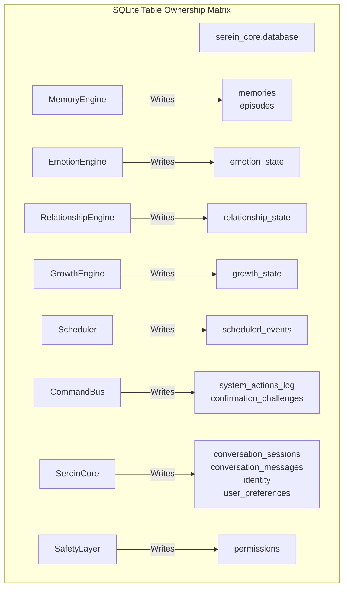
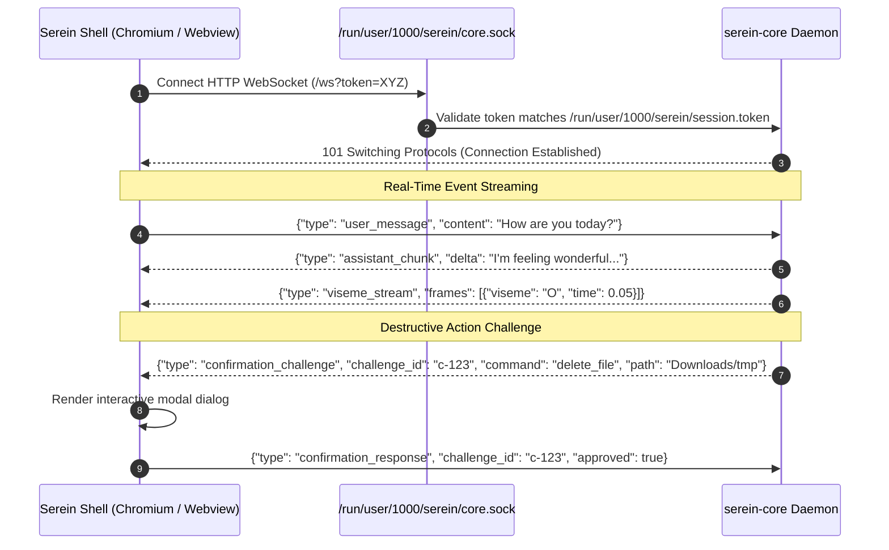

# SereinOS — Canonical Interface Contracts & Data Ownership

**Document Version:** 1.0  
**Status:** Approved Architectural Contract  
**Scope:** Public interfaces, data schemas, database table ownership, EventBus events, and IPC contracts across all SereinOS subsystems.

---

## 1. Architectural Invariants & Data Ownership Matrix

To prevent circular dependencies, conflicting writes, and distributed state corruption, every SQLite table and system resource has **one single owner** with write authority. All other modules access state through asynchronous queries or EventBus notifications.



### Table Ownership Table

| SQLite Table | Exclusive Owning Subsystem | Write Conditions | Read Access |
| :--- | :--- | :--- | :--- |
| `identity` | `SereinCore` | System onboarding / user profile edit | All subsystems |
| `personality_state` | `SereinCore` | System initialization / tuning | Emotion, Brain |
| `emotion_state` | `EmotionEngine` | After conversational turns & hourly decay | Performance, Brain, UI |
| `relationship_state`| `RelationshipEngine` | After meaningful interactions | Brain, Decision, UI |
| `growth_state` | `GrowthEngine` | After domain-specific user interactions | Brain, UI |
| `memories` | `MemoryEngine` | User fact extraction & reinforcement | Brain, Decision |
| `episodes` | `MemoryEngine` | Milestone event recording | Brain, UI |
| `goals` / `tasks` | `AgentEngine` | Task planning & completion | UI, Brain |
| `scheduled_events` | `Scheduler` | User creates/cancels reminders; status update | Core, UI |
| `system_actions_log`| `CommandBus` | Every command invocation & permission rejection | UI, Security audit |
| `confirmation_challenges`| `CommandBus` | Challenge generation & atomic consumption | SafetyGate, WebApp |
| `permissions` | `SafetyLayer` | User toggles hardware permissions in UI | Decision, Voice, Vision |
| `conversation_sessions`| `SereinCore` | Session start and clean shutdown | UI, Memory |
| `conversation_messages`| `SereinCore` | Every user query and assistant response | Memory, Brain, UI |
| `user_preferences` | `SereinCore` | Explicit setting updates | All subsystems |
| `schema_version` | `Database` | Migration execution at boot | Core startup check |

---

## 2. Canonical Python Interfaces & Method Signatures

### 2.1 Core Lifecycle Engine (`serein_core.main.SereinCore`)
- **Module:** `serein_core.main`
- **Owner:** Core Daemon
```python
class SereinCore:
    def __init__(self, config: Optional[CoreConfig] = None) -> None: ...
    async def initialize(self) -> None: ...
    async def shutdown(self) -> None: ...
    async def process_input(
        self, 
        user_input: str, 
        context: Optional[Dict[str, Any]] = None, 
        session_id: Optional[str] = None,
        **kwargs: Any
    ) -> Dict[str, Any]: ...
    def get_greeting(self) -> str: ...
```

### 2.2 Intent System (`serein_core.intent.classifier.IntentClassifier`)
- **Module:** `serein_core.intent.classifier`
- **Owner:** Pure Intent Parser
```python
@dataclass(frozen=True)
class IntentResult:
    intent: str                          # "system_control", "app_control", "file_operation", "reminder", etc.
    confidence: float                    # 0.0 to 1.0
    entities: Dict[str, Any]             # e.g. {"action": "delete", "path": "~/Downloads/temp"}
    raw_text: str                        # Original input string

class IntentClassifier:
    def classify(self, text: str) -> IntentResult: ...
```

### 2.3 Decision Engine (`serein_core.decision.DecisionEngine`)
- **Module:** `serein_core.decision`
- **Owner:** Routing Orchestrator
```python
class Route(Enum):
    BRAIN = "brain"
    COMMAND_BUS = "command_bus"
    SCHEDULER = "scheduler"
    CLARIFY = "clarify"
    BLOCKED = "blocked"

@dataclass(frozen=True)
class Decision:
    route: Route
    action: str                          # Specific command or generator name
    confidence: float                    # Routing confidence
    parameters: Dict[str, Any]           # Parameters prepared for execution
    requires_confirmation: bool          # True if DESTRUCTIVE or SENSITIVE
    reason: str                          # Human-readable routing explanation

class DecisionEngine:
    async def decide(
        self, 
        intent: IntentResult, 
        context: Optional[ContextState] = None,
        safety_status: Optional[Dict[str, Any]] = None,
        user_confirmation: bool = False
    ) -> Decision: ...
```

### 2.4 Safety Layer (`serein_core.safety_layer.SafetyLayer`)
- **Module:** `serein_core.safety_layer`
- **Owner:** Security Gatekeeper
```python
class PermissionLevel(Enum):
    NONE = 0
    READ = 1
    WRITE = 2
    ADMIN = 3

class ActionRisk(Enum):
    NONE = 0
    LOW = 1
    MEDIUM = 2
    HIGH = 3
    CRITICAL = 4

@dataclass(frozen=True)
class SafetyValidationResult:
    allowed: bool
    risk: ActionRisk
    requires_confirmation: bool
    reason: str
    challenge_id: Optional[str] = None   # UUID if confirmation challenge created

class SafetyLayer:
    async def validate_action(
        self, 
        action: str, 
        params: Dict[str, Any], 
        session_id: str
    ) -> SafetyValidationResult: ...
    
    def check_hardware_permission(self, device: str) -> bool: ...
```

### 2.5 Command Bus (`serein_core.command_bus.CommandBus`)
- **Module:** `serein_core.command_bus`
- **Owner:** OS Execution Subsystem
```python
class PermissionTier(Enum):
    READ_ONLY = "read_only"
    REVERSIBLE = "reversible"
    SENSITIVE = "sensitive"
    DESTRUCTIVE = "destructive"

@dataclass(frozen=True)
class CommandResult:
    success: bool
    result: Optional[Dict[str, Any]] = None
    error: Optional[str] = None
    permission_tier: PermissionTier = PermissionTier.READ_ONLY
    requires_confirmation: bool = False
    challenge_id: Optional[str] = None

class CommandBus:
    async def execute(
        self, 
        command: str, 
        params: Dict[str, Any], 
        challenge_id: Optional[str] = None,
        session_id: Optional[str] = None
    ) -> CommandResult: ...
    
    def register_command(
        self, 
        name: str, 
        handler: Callable[[Dict[str, Any]], Awaitable[CommandResult]], 
        tier: PermissionTier, 
        requires_confirmation: bool = False
    ) -> None: ...
```

### 2.6 Local Brain & Brain Router (`serein_core.local_brain`, `serein_core.ai`)
- **Module:** `serein_core.ai`, `serein_core.local_brain`
- **Owner:** Intelligence Engine
```python
@dataclass
class ChatMessage:
    role: str                            # "system", "user", "assistant"
    content: str
    timestamp: Optional[datetime] = None

@dataclass
class ChatResponse:
    content: str
    model: str
    tier: ModelTier
    latency_ms: int
    provider: str
    finish_reason: str = "stop"

class LocalBrainEngine:
    def chat_sync(self, user_text: str, context: Optional[Dict[str, Any]] = None) -> str: ...
    async def chat(self, user_text: str, context: Optional[Dict[str, Any]] = None) -> str: ...

class BrainRouter:
    async def chat(
        self, 
        messages: List[ChatMessage], 
        tier: ModelTier = ModelTier.FAST, 
        prefer_local: bool = False, 
        **kwargs: Any
    ) -> ChatResponse: ...
```

### 2.7 Persistent Scheduler (`serein_core.scheduler.Scheduler`)
- **Module:** `serein_core.scheduler`
- **Owner:** Persistent Job Subsystem
```python
class TriggerType(Enum):
    ABSOLUTE = "absolute"
    RELATIVE = "relative"
    RECURRING = "recurring"
    CONDITIONAL = "conditional"

@dataclass
class ScheduledEvent:
    id: str                              # UUIDv4
    trigger_type: TriggerType
    message: str
    fires_at: Optional[datetime] = None
    recurrence_rule: Optional[str] = None  # Standard cron expression
    condition_spec: Dict[str, Any] = field(default_factory=dict)
    status: str = "pending"              # "pending", "fired", "cancelled"
    payload: Dict[str, Any] = field(default_factory=dict)

class Scheduler:
    async def start(self) -> None: ...
    async def stop(self) -> None: ...
    async def schedule_event(self, event: ScheduledEvent) -> str: ...
    async def cancel_event(self, event_id: str) -> bool: ...
    async def get_pending_events(self) -> List[ScheduledEvent]: ...
```

### 2.8 Voice Subsystem (`serein_voice.voice_engine.VoiceEngine`)
- **Module:** `serein_voice.voice_engine`
- **Owner:** Speech Pipeline
```python
@dataclass
class TTSResponse:
    audio_data: bytes                    # 16-bit PCM WAV (16kHz or 22.05kHz)
    sample_rate: int
    visemes: List[Dict[str, Any]]        # [{"time": 0.12, "viseme": "AA", "weight": 0.85}]

@dataclass
class STTResponse:
    text: str
    confidence: float
    duration_ms: int
    words: List[Dict[str, Any]]

class VoiceEngine:
    async def initialize(self) -> None: ...
    async def synthesize(self, text: str, voice: Optional[str] = None) -> TTSResponse: ...
    async def transcribe(self, audio_data: bytes, sample_rate: int = 16000) -> STTResponse: ...
```

---

## 3. EventBus Event Catalog & Schemas

All components communicate asynchronously via `serein_core.events.event_bus`. Events are decoupled from handlers.

| Event Type Name (`CoreEvents`) | Publisher | Primary Subscribers | Payload Schema |
| :--- | :--- | :--- | :--- |
| `system.started` | `SereinCore` | WebApp, Voice, Compositor | `{"timestamp": str, "tier": str}` |
| `system.shutdown` | `SereinCore` | Scheduler, Voice, DB | `{"reason": str}` |
| `core.voice_input` | `VoiceEngine` | `SereinCore` | `{"text": str, "confidence": float, "duration": float}` |
| `core.voice_output` | `SereinCore` | `VoiceEngine`, Kiosk Shell | `{"text": str, "audio_b64": str, "visemes": list}` |
| `core.confirmation_requested` | `SafetyLayer` | Kiosk Shell UI | `{"challenge_id": str, "command": str, "prompt": str, "params": dict, "expires_at": float}` |
| `core.command_executed` | `CommandBus` | Memory, Kiosk Shell UI | `{"command": str, "params": dict, "result": dict}` |
| `core.command_failed` | `CommandBus` | Memory, UI Notifications | `{"command": str, "error": str}` |
| `system.state_changed` | `ContextEngine` | Brain, Decision, UI | `{"internet_connected": bool, "active_app": str, "battery": int}` |
| `scheduler.event_fired` | `Scheduler` | `SereinCore`, UI | `{"event_id": str, "message": str, "trigger_type": str}` |
| `emotion.state_updated` | `EmotionEngine`| Performance, Kiosk UI | `{"happiness": int, "curiosity": int, "care": int, ...}` |

---

## 4. Inter-Process Communication (IPC) Protocol

The Kiosk Shell connects to the Core Daemon over a private UNIX Domain Socket:
- **Socket Path:** `/run/user/<UID>/serein/core.sock`
- **File Permissions:** Mode `0600` (`serein:serein` only)
- **Protocol:** HTTP/1.1 and WebSockets over UNIX socket (or local loopback `http://127.0.0.1:8000` bound to localhost with session token)



---

## 5. File System & Sandbox Boundary Definitions

### Explicit Directory Access Matrix

| Path on Disk | Classification | Read Policy | Write Policy | Delete Policy |
| :--- | :--- | :--- | :--- | :--- |
| `~/Documents/Serein/` | **Workspace Root** | Unrestricted | Unrestricted | Move to Trash |
| `/tmp/serein/` | **Temporary Sandbox**| Unrestricted | Unrestricted | Immediate Unlink |
| `~/.local/share/serein/` | **Internal App Data** | Daemon only | Daemon only | Prohibited via CommandBus |
| `~/Downloads/` | **User Document Folder**| Permitted with `file_access` | Requires confirmation | Move to Trash (Challenge) |
| `~/Documents/` | **User Document Folder**| Permitted with `file_access` | Requires confirmation | Move to Trash (Challenge) |
| `~/Desktop/`, `~/Pictures/` | **User Document Folder**| Permitted with `file_access` | Requires confirmation | Move to Trash (Challenge) |
| `/`, `/etc`, `/usr`, `/boot` | **System System Roots**| **FORBIDDEN** | **FORBIDDEN** | **FORBIDDEN** |
| `~/.ssh/`, `~/.gnupg/` | **Credential Roots** | **FORBIDDEN** | **FORBIDDEN** | **FORBIDDEN** |

- **Symlink Resolution:** Paths are resolved using `Path(target).expanduser().resolve()` before checking against allowed roots.
- **Trash Invariant:** No file in user directories is ever hard-deleted directly. Deletions invoke `gio trash` or `send2trash`, enabling 100% user recovery from `~/.local/share/Trash`.
